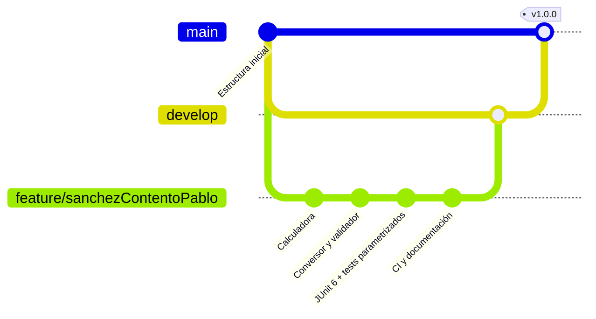

# Práctica JUnit 6 · Entornos de Desarrollo

[](https://github.com/sanchezcontentopablo-max/practica-junit6-endes1/actions/workflows/ci.yml)


Tres clases de utilidad en Java desarrolladas con **pruebas unitarias en JUnit 6**
y siguiendo el flujo de ramas **GitFlow**. Práctica de la asignatura *Entornos
de Desarrollo* (1.º DAW).

## Funcionalidad

| Clase | Qué hace | Casos especiales |
|---|---|---|
| [`Calculadora`](src/main/java/edu/sanchezContentoPablo/endes/Calculadora.java) | suma, resta, multiplica y divide | dividir entre `0` o `-0.0` lanza `IllegalArgumentException` |
| [`ConversorTemperatura`](src/main/java/edu/sanchezContentoPablo/endes/ConversorTemperatura.java) | convierte entre °C y °F | rechaza temperaturas bajo el cero absoluto |
| [`ValidadorPassword`](src/main/java/edu/sanchezContentoPablo/endes/ValidadorPassword.java) | comprueba la seguridad de una contraseña | `errores()` explica qué reglas se incumplen |

### Reglas de contraseña

Una contraseña es válida si no es `null`, tiene **8 o más caracteres**, al menos
**una mayúscula** y al menos **un número**.

```java
ValidadorPassword validador = new ValidadorPassword();

validador.validar("Password123");   // true
validador.errores("abc");
// [Debe tener al menos 8 caracteres,
//  Debe contener al menos una letra mayúscula,
//  Debe contener al menos un número]
```

## Pruebas

**54 tests** que cubren el **100 % de líneas y ramas**. La build falla si la
cobertura baja de ese umbral (JaCoCo).

Técnicas de JUnit 6 utilizadas:

- `@ParameterizedTest` con `@CsvSource` y `@ValueSource` para probar muchos casos con un solo método.
- `@Nested` para agrupar tests relacionados.
- `@DisplayName` para que el informe se lea como una especificación.
- `assertThrows` comprobando también el mensaje de la excepción.
- Casos límite: `-0.0`, cero absoluto, longitud mínima exacta, letras no ASCII (`Ñ`).

```text
Calculadora (22)
Conversor de temperatura (16)
Validador de contraseñas
├── validar() (12)
└── errores() (4)
```

## Uso

Requisitos: JDK 21+ y Maven 3.9+ (o el Maven integrado en IntelliJ IDEA).

```bash
mvn test              # ejecutar los tests
mvn verify            # tests + comprobación de cobertura
mvn javadoc:javadoc   # documentación en target/reports/apidocs/
```

El informe de cobertura queda en `target/site/jacoco/index.html`.

## Flujo de trabajo (GitFlow)



- `main`: versiones estables.
- `develop`: integración.
- `feature/*`: desarrollo de cada funcionalidad, integrado mediante *pull request*.

## Autor

**Pablo Sánchez Contento** · [GitHub](https://github.com/sanchezcontentopablo-max)
